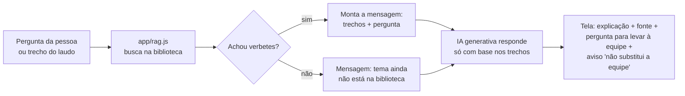

# Prova — Base de dados (Edital, seção 2)

> Requisito: dados reais que a solução consulta ou alimenta.
> Prova: **onde é usada** e **dados higienizados**.

## 1. Que base é esta
Biblioteca de conhecimento do Tradutor da Saúde: **77 verbetes** (51 transplante · 26 paliativos),
em `dados/biblioteca.json`, construída a partir de fontes reais e citadas:

| Fonte | Tipo | Verbetes |
|---|---|---|
| Guia de orientações para o transplante de fígado (Ministério da Saúde / PROADI-SUS, 2026) | aberta | 21 |
| Site e blog do Prof. Dr. Luiz Augusto Carneiro D'Albuquerque (FMUSP) — 7 posts do blog + 13 páginas das seções Doenças e Transplantes | aberta | 27 |
| Ministério da Saúde — Sistema Nacional de Transplantes (SNT) | aberta | 2 |
| Portaria GM/MS nº 8.041/2025, Módulo Fígado (lista de doenças, reproduzida pela SMS de Belo Horizonte) | aberta | 1 |
| Organização Mundial da Saúde — definição de cuidados paliativos (citada em Gomes & Othero, *Estudos Avançados*, 2016) | aberta | 1 |
| Anotações próprias do curso *Como Trazer Paz para a Morte* (Dra. Ana Claudia Quintana Arantes) | resumo próprio | 25 |

Cada verbete traz: tema, termos de busca, explicação em linguagem simples (40–120 palavras),
perguntas para levar à equipe, fonte, link, data de acesso, origem (trecho de onde saiu),
notas de curadoria e status de revisão.

Sem dados de pacientes: nenhuma pessoa real é identificável na base (LGPD). Casos de pacientes
contados nas aulas foram descartados.

## 2. Onde é usada
Fluxo do Tradutor da Saúde:



Implementação: `app/servidor.js` (servidor local) + `cuidar_v5.html` (tela "Tradutor da Saúde").
O servidor funciona em dois modos: **modo IA**, quando há chave da API (a IA explica usando só os verbetes
encontrados), e **modo biblioteca**, sem chave (a tela mostra o verbete encontrado, exatamente como está na
base, com fonte e perguntas para a equipe). Nos dois modos, a base de dados é o que responde.

Versão em texto (caso o Mermaid não apareça):

```
Pergunta da pessoa
   → app/rag.js busca os verbetes mais parecidos em dados/biblioteca.json
   → monta a mensagem: trechos + pergunta
   → IA generativa responde só com base nos trechos, citando a fonte
   → tela mostra a explicação + fonte + pergunta para levar à equipe
```

Exemplo real de busca (saída de `node app/rag.js`):

```
Pergunta: minha mãe diz que não quer dar trabalho
Verbetes encontrados: cp-025 (7.4), cp-023 (2.2)
```

Quando a biblioteca não tem o tema, a busca não traz verbete errado e a IA responde que a
informação ainda não está na biblioteca:

```
Pergunta: se tomar morfina agora depois não faz efeito?
Verbetes encontrados: nenhum
```

Teste automático da busca: `node scripts/testar_busca.js` — **82 de 82** perguntas, escritas do
jeito que pacientes e cuidadoras falam, encontram o verbete certo em 1º lugar.

Print 1: tela do Tradutor com a resposta e a fonte. _(colar aqui)_
Print 2: saída de `node app/rag.js "<pergunta>"` mostrando os verbetes encontrados. _(colar aqui)_

## 3. Dados higienizados
Números (de `dados/limpos/relatorio_limpeza.md` e de `scripts/validar_biblioteca.py`):

| Medida | Antes | Depois |
|---|---|---|
| Transcrição bruta do curso | 9.699 palavras · 243 parágrafos | 9.601 palavras · 236 parágrafos |
| Linhas de plataforma/conversa de aula removidas | — | 7 |
| Trechos limpos para curadoria | — | 48 |
| Trechos com suspeita de erro de transcrição (revisados à mão) | — | 2 marcados pelo script + 3 achados na curadoria |
| Verbetes finais | — | 77 (26 paliativos · 51 transplante) |
| Validação automática | — | 0 erros |
| Revisão humana (checklist de `docs/regras-higienizacao.md`) | — | 77 de 77 revisados por Sueide (14/11/2026) |
| Teste de busca | — | 82 de 82 |

### Antes e depois (1 exemplo)
**Antes** (trecho bruto da transcrição `paliativos-t010`, encurtado):
> "Aí Ana, mas se Deus quiser nada de ruim vai acontecer?", então talvez Deus não queira, mas existe
> uma séria possibilidade de haver sofrimento nessas cinco dimensões quando uma pessoa está diante do
> adoecimento numa fase muito avançada dessa jornada. O sofrimento então ele vai ser avaliado…

**Depois** (verbete `cp-002`, origem `paliativos-t009` a `t012`):
> Quando a doença grave está numa fase muito avançada, existe uma séria possibilidade de sofrimento em
> cinco dimensões. A física, ligada à piora da doença ou ao tratamento. A emocional, com cansaço,
> mal-estar, fraqueza, dor, falta de ar, problema no intestino, falta de apetite, sono alterado,
> depressão, angústia, ansiedade e medo. A espiritual, quando é a alma que dói. A familiar, porque
> ninguém adoece sozinho. E a social: a fragilidade, o emprego, o dinheiro, os amigos e os recursos
> para cuidar da saúde. O cuidado paliativo alivia o sofrimento que está acontecendo e age na
> prevenção do sofrimento.

Outros exemplos de erros de transcrição corrigidos e registrados em `notas_curadoria`:
"luta antecipatório" → "luto antecipatório" (t006), "cuidados negativos" → "cuidados paliativos" (t017),
"casa hospitalar" → "cama hospitalar" (t029). Trechos muito truncados (t047, t048, com "mochila" no
lugar de "morfina") não viraram verbete e foram registrados como lacuna.

### O que a higienização fez
- removeu textos da plataforma, marcações e falas de aula (script `limpar_transcricao.py`);
- corrigiu erros de transcrição, sempre registrando a correção em `notas_curadoria`;
- descartou histórias pessoais, casos de pacientes e números ditos em aula sem fonte;
- reescreveu em linguagem simples para pessoas idosas, **sem acrescentar nada que a fonte não diga**:
  cada verbete registra de qual trecho saiu cada frase e quais palavras foram trocadas
  (regra "não inventar nada", em `docs/regras-higienizacao.md`);
- usou uma fonte por verbete, com link do documento ou post específico e data de acesso;
- registrou em `docs/lacunas.md` os temas importantes que ainda não têm fonte, em vez de inventar;
- passou no validador (sem dado pessoal, sem dose, sem fonte não aprovada, sem texto acima de 120 palavras).
- passou pela revisão humana da autora: os 77 verbetes estão com `"status": "revisado"` e `"revisado_por": "Sueide"`.
